# Glenn

**Systems Builder · Founder · Software Developer**

I build systems — not just software.

I turn messy business processes into clean, repeatable infrastructure. Especially for African B2B founders who sell on WhatsApp.

Founder of **[African Scaling](https://african-scaling-site.vercel.app)** and **[Scale OS](https://scaleos-gray.vercel.app)**.

---

### Building right now

- **[Scale OS](https://scaleos-gray.vercel.app)** — Dual-channel sales operating system (WhatsApp + Email)
- **[African Scaling](https://african-scaling-site.vercel.app)** — Systems & media brand for African founders
- Client systems, websites, and internal tools

---

### What I Build

- Business systems that turn chaos into process
- WhatsApp-native sales & operational infrastructure
- Clean, fast websites and web applications
- Founder operating systems that create leverage

---

### Tech Stack

  

---

### Stats

<!-- Cards auto-update every six hours via GitHub Actions; private contributions require GH_STATS_TOKEN -->

---

### Work with me

- **Email** → johnatinda2@gmail.com
- **X** → [@its_glenn01](https://x.com/its_glenn01)
- Open to: sales systems, WhatsApp automation, founder OS builds, and high-ticket infrastructure work

---

> Build like a machine. Live like a human.
